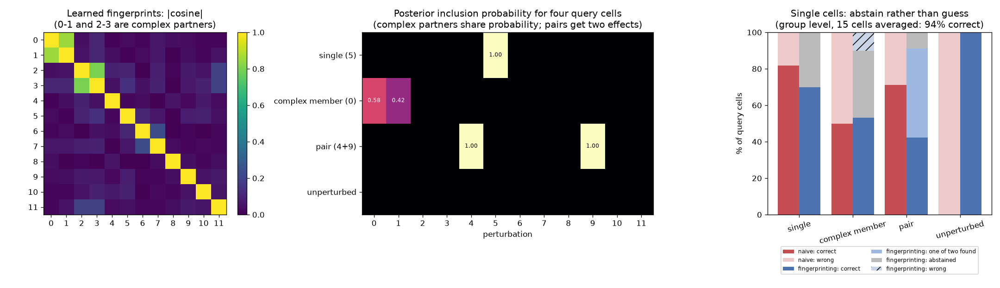

# Perturbation Fingerprinting

> "Which knockout does this cell look like?" Sometimes the honest answer is "one of these two", "both", or "none of them".

## Demo Output

Produced by `demo.py`. A reference dictionary has 12 perturbations; two pairs are protein-complex partners. A query experiment adds a different baseline (its treated cells cycle more), cells hit by two perturbations, and unperturbed cells. Left: how alike the learned fingerprints are. Middle: posterior probabilities for four example cells. Right: correct, abstained and wrong calls compared with naive correlation matching.

## Why This Exists

Genome-scale Perturb-seq screens are now *dictionaries*: for thousands of perturbations, they record how the transcriptome responds. Grabski et al. (*Cell* 2026) asked the reverse question. Given cells from a new experiment, which dictionary entries explain them?

Their framework, RNA fingerprinting, has two stages. This repo re-implements both, compactly, in Python. The authors' own package is in R.

## How It Works

**Stage 1: learn fingerprints.**
1. Fit PCA on control cells. Those components are "baseline" variation every cell has: cell cycle, differentiation, stress.
2. For each perturbation, remove the baseline components from its cells.
3. Take the leading singular vector of what remains. That vector is the fingerprint. Cell-to-cell response strength just scales it.

**Stage 2: map query cells.**
1. Remove the *query's* own baseline, estimated from its own control cells.
2. Regress each cell on all fingerprints with SuSiE (sum of single effects). Each effect picks one fingerprint, with a posterior over which one.
3. Report 95% credible sets. Similar fingerprints share probability (0.58 / 0.42 in the middle panel) instead of the method guessing.
4. Two effects mean two perturbations. No effect with enough support means "no match".

## What the Demo Shows

| Query cells | Naive top match correct | Fingerprinting correct | Fingerprinting wrong |
|-------------|------------------------|------------------------|----------------------|
| Single perturbation | 82% | 70% (30% abstain) | **0%** |
| Complex member | 50% | 53% (credible sets name both partners) | 10% |
| Two perturbations | 71% *(told there were two)* | 42% both + 49% one | **0%** |
| Unperturbed | 0% (can't say "none") | **100%** | 0% |
| Groups of 15 cells averaged | | 94% | |

The naive matcher looks better on single cells only because it never abstains. It is also wrong 18% of the time without warning.

## When NOT to Use This

- **Query contexts far from the reference** (a different cell type or species). Fingerprints learned in K562 cells may not transfer. The paper checks this explicitly; this toy does not.
- **No query control cells.** Baseline removal needs them.
- **As a production tool.** This is the core statistics only. The real method also adds SCTransform normalisation, outlier correction, fingerprint uncertainty and joint fingerprints for known combinations.

## The Uncomfortable Truth

Single-cell responses are weak and variable. Cells with low response strength are honestly unassignable, and a method that always names a top hit is hiding that. If a decision depends on the answer, aggregate cells (by cluster, donor or condition) before mapping. In the demo that took accuracy from 70% to 94%.

## Further Reading

- Grabski I. N. et al. "Mapping transcriptional responses to cellular perturbations with RNA fingerprinting." Cell (2026). doi:10.1016/j.cell.2026.09.017. Preprint: bioRxiv doi:10.1101/2025.09.19.676866
- Wang G. et al. "A simple new approach to variable selection in regression, with application to genetic fine mapping." JRSS-B (2020).
- Replogle J. M. et al. "Mapping information-rich genotype-phenotype landscapes with genome-scale Perturb-seq." Cell (2022).
